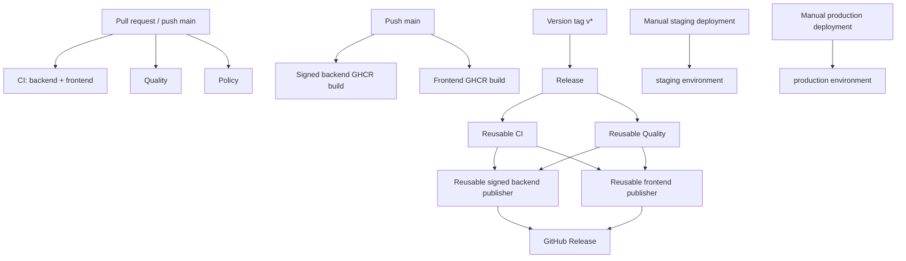

# ERP03 GitHub Actions — Pipeline and Environment Contract

**Scope:** `nyeinpyaesone-ui/ERP03`  
**Status:** implementation proposal on a review branch; not a production deployment approval.

## Pipeline topology

### Event and hand-off rules

- `workflow_call` is the in-repository contract for deterministic pipeline reuse. Release calls CI and Quality in parallel, then calls the signed backend publisher and frontend publisher only after both pass. The reusable image workflows expose `backend_digest` and `frontend_digest`; Release includes both immutable references in its release notes for downstream staging/production inputs.
- `needs` enforces ordering and propagates failure. A release cannot be created if qualification or either image publication fails.
- Pull requests build images without pushing. Pushes to `main` publish backend and frontend images through their dedicated workflows. Version tags are handled by Release, which calls `docker-publish.yml` for the signed backend and `container.yml` for the frontend; direct tag triggers were removed from the backend publisher to prevent duplicate builds.
- `workflow_dispatch` remains available on CI for an operator-requested qualification run.
- Use `repository_dispatch` only when an external system must initiate a repository workflow. Keep `event_type` names explicit and validate payload fields; never pass secrets or arbitrary shell fragments in `client_payload`.
- Do not use `workflow_run` as the default internal dependency mechanism. Reusable workflows plus `needs` provide a direct dependency graph and clearer failure propagation.

## Current verification findings

- `.github/workflows/policy.yml` is present. Policy Enforcement run #495 on PR #318 ended `startup_failure` with zero jobs; no job logs exist, so the startup cause remains unresolved.
- On prior branch head `5a1d792666ceb4d6e322ff77723ad69e92cd7aa9`, CI backend/frontend, Quality, Docker backend publisher, Frontend Container, Coverage and Type Check completed successfully. Agent Parity and Devcontainer Build were still running at last inspection.
- Current branch head is `8f5e6d14f999f5a1d81eba33e7900f09e560c70c`; no PR-triggered run is currently returned for that head. The final Compose image-tag correction therefore still needs a fresh qualification run.
- The Policy Enforcement startup issue is separate from the reusable release chain and must be fixed before claiming all repository checks are green.

## Registry and token model

| Use | Credential | Required permission | Store as Environment secret? |
|---|---|---|---|
| Checkout / changelog / GitHub Release | Built-in `GITHUB_TOKEN` | `contents: read` for CI; `contents: write` only for release job | No |
| Publish ERP03 images to GHCR | Built-in `GITHUB_TOKEN` | `packages: write` on publishing caller/workflow | No |
| Read GHCR images during deployment | Deployment job's `GITHUB_TOKEN` where package access permits, otherwise a narrowly scoped package-read credential | `packages: read` | Only if the package access model requires it |
| Docker Hub | Not used by the current GHCR pipeline | None | Do not create `DOCKERHUB_USERNAME` / `DOCKERHUB_TOKEN` for this pipeline |
| PyPI | Not configured as a supported ERP03 package release yet | Future option: PyPI Trusted Publishing via OIDC | Do not create `PYPI_TOKEN` now |

The root `pyproject.toml` currently contains tool configuration only; it has no project/build-system metadata. Therefore the former static-token PyPI step was not a verified package-release path and is removed from this release workflow. If a Python distribution is added later, configure PyPI Trusted Publishing for the exact repository, workflow and `pypi` environment, then grant `id-token: write` only to that publishing job. Do not reintroduce a long-lived PyPI token by default.

## GitHub Environments and variables

The repository already has deployment workflows referencing the `staging` and `production` GitHub Environments. The connector can inspect workflow references but cannot verify the actual Environment secret/variable values or protection rules, and it cannot write secret values. Configure the following names under **Settings → Environments**; do not create placeholder values.

### `staging` Environment

**Secrets**
- `STAGING_SSH_PRIVATE_KEY` — deployment account private key.
- `STAGING_SSH_KNOWN_HOSTS` — pinned SSH host key lines; do not discover trust at deploy time.

**Variables**
- `STAGING_SSH_HOST`
- `STAGING_SSH_USER`
- `STAGING_SSH_PORT` — optional; defaults to 22.
- `STAGING_DEPLOY_PATH` — existing clean checkout containing the Compose deployment files and server-managed runtime `.env`.

GHCR access uses the workflow's ephemeral `GITHUB_TOKEN` with `packages: read`; no long-lived `STAGING_GHCR_READ_TOKEN` or GHCR username secret is required after this branch is merged.

### `production` Environment

**Secrets**
- `DEPLOY_SSH_PRIVATE_KEY`
- `DEPLOY_SSH_KNOWN_HOSTS`

**Variables**
- `DEPLOY_HOST`
- `DEPLOY_USER`
- `DEPLOY_PATH`
- `DEPLOY_ENV_FILE` — absolute path to the server-managed Compose environment file, outside the uploaded release directory.
- `DEPLOY_SSH_PORT` — optional; defaults to 22.

GHCR access uses the workflow's ephemeral `GITHUB_TOKEN` with `packages: read`; no long-lived `GHCR_TOKEN` or `GHCR_USERNAME` Environment secret is required after this branch is merged.

### Server-managed runtime configuration

The server-side environment file referenced by `STAGING_DEPLOY_PATH` / `DEPLOY_ENV_FILE` must be provisioned securely on each host and must not be copied from GitHub Actions artifacts. It supplies the Compose-required runtime values:

- `SECRET_KEY`
- `DATABASE_URL` (URL-encoded `postgresql+asyncpg://` DSN)
- `CORS_ORIGINS` (real HTTPS origins in production)
- `POSTGRES_PASSWORD` and `REDIS_PASSWORD` when the Compose-managed database/cache services are enabled
- Optional `TYPESAFE_API_KEY`, `WEBHOOK_SECRET`, and observability configuration only when those features are enabled

Do not store application database credentials in repository variables or pass them through build args, dispatch payloads, logs or artifacts. Restrict the server-side env file to the deployment account and keep it outside the release checkout.

### Token and external hook policy

| Use | Credential | Permission |
|---|---|---|
| CI / checkout | Built-in `GITHUB_TOKEN` | `contents: read` |
| GHCR publishing | Built-in `GITHUB_TOKEN` | `packages: write` |
| Staging/production GHCR pulls | Built-in `GITHUB_TOKEN` | `packages: read` |
| GitHub Release | Built-in `GITHUB_TOKEN` | `contents: write` only on release job |
| Backend image signing | GitHub OIDC | `id-token: write` only on backend publisher job |
| PyPI | Not configured as a supported ERP03 package release yet | Do not create `PYPI_TOKEN`; add PyPI Trusted Publishing only after package metadata exists |

The root `pyproject.toml` currently contains tool configuration only, not project/build-system metadata. Static-token PyPI publishing is therefore removed. If a Python distribution is added later, configure PyPI Trusted Publishing for the exact repository/workflow/environment and grant `id-token: write` only to that job.

For an external event producer, the supported GitHub dispatch endpoint is `POST /repos/{owner}/{repo}/dispatches` with a narrowly scoped GitHub App installation token (`contents: write`) and an explicit `event_type`. No `repository_dispatch` trigger is currently configured in ERP03; do not expose one until an external producer and payload schema are known. Internal pipeline dependencies should continue to use `workflow_call` + `needs`.

### Protection requirements

- Require environment reviewers for production where supported; prevent self-review and bypass.
- Restrict deployment branches to `main` for staging and the approved release path for production.
- Use immutable image digests for both staging and production. Production validates both SHA-256 digests and checks each OCI revision label against the checked-out release-tag commit.
- Staging workflow performs health checks and rollback. Production workflow performs health checks but does not yet implement automatic rollback; production readiness remains incomplete until rollback is added and tested.
- The legacy canary workflow is now disabled because it used Docker Hub and example domains rather than a verified deployment target.

## Current repository mismatches addressed by this change

- Release gates CI and Quality through parallel `workflow_call` jobs; they remain separate checks on pull requests.
- Release now depends on CI/Quality, then on the existing signed backend publisher and the frontend GHCR publisher.
- Backend publication remains in `docker-publish.yml` with cosign signing/verification; `container.yml` owns the frontend image. Both publish multi-architecture manifests.
- Tag-triggered backend publication is routed through Release, preventing duplicate builds against the direct tag trigger.
- Static `PYPI_TOKEN` publishing is removed until ERP03 has package metadata and a configured trusted publisher.

## Implementation checklist

- [x] Inspect current `main` workflows, Dockerfiles, Compose image names, settings and open PR inventory.
- [x] Confirm all newly referenced Actions use full commit SHAs.
- [x] Add reusable workflow contracts, image-digest outputs and explicit `needs` ordering.
- [x] Reuse the signed backend GHCR workflow and retain frontend multi-architecture manifest verification.
- [x] Publish backend/frontend digests in release notes for downstream deployment inputs.
- [x] Use built-in read-only `GITHUB_TOKEN` for staging/production GHCR pulls; separate SSH secrets from non-sensitive Environment variables.
- [x] Make production deployment consume immutable image digests and verify source-revision labels.
- [x] Remove unverified static PyPI-token publishing path.
- [ ] Confirm actual staging/production Environment variables, secrets and protection rules in GitHub Settings; workflow references alone do not prove they are configured.
- [ ] Populate runtime secrets through GitHub Settings using newly generated values; values cannot be read back through the GitHub API.
- [ ] Obtain a fresh PR run on head `8f5e6d14f999f5a1d81eba33e7900f09e560c70c`; prior-head runs do not validate the final setup image-tag change.
- [ ] Resolve `.github/workflows/policy.yml` startup failure and verify GHCR package access for the deployment workflow's built-in read-only token.
- [ ] Add and test automatic rollback for production; staging already has a rollback path.

## Explicit non-goals

- No live deployment, secret value upload, branch protection change or merge.
- No application webhook endpoint was added: the backend exposes webhook settings but no verified webhook router contract. No external `repository_dispatch` producer is configured.
- No unrelated ERP domain/model changes.
- Existing PRs #311, #312, #315, #316 and #317 remain independent and unmodified by this branch.
