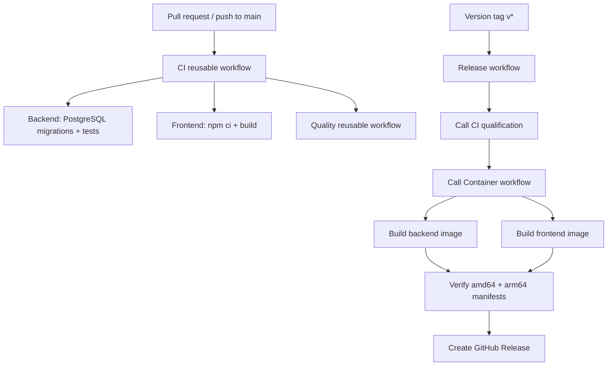

# ERP03 GitHub Actions — Pipeline and Environment Contract

**Scope:** `nyeinpyaesone-ui/ERP03`  
**Status:** implementation proposal on a review branch; not a production deployment approval.

## Pipeline topology

### Event and hand-off rules

- `workflow_call` is the in-repository contract for deterministic pipeline reuse. CI calls Quality; Release calls CI and then Container.
- `needs` enforces ordering and propagates failure. A release cannot be created if qualification or either image publication fails.
- Pull requests build both images without pushing. Pushes to `main` and `release/**` publish images. Version tags are handled by Release, which calls Container once; this avoids a second independent tag-triggered build.
- `workflow_dispatch` remains available on CI for an operator-requested qualification run.
- Use `repository_dispatch` only when an external system must initiate a repository workflow. Keep `event_type` names explicit and validate payload fields; never pass secrets or arbitrary shell fragments in `client_payload`.
- Do not use `workflow_run` as the default internal dependency mechanism. Reusable workflows plus `needs` provide a direct dependency graph and clearer failure propagation.

## Registry and token model

| Use | Credential | Required permission | Store as Environment secret? |
|---|---|---|---|
| Checkout / changelog / GitHub Release | Built-in `GITHUB_TOKEN` | `contents: read` for CI; `contents: write` only for release job | No |
| Publish ERP03 images to GHCR | Built-in `GITHUB_TOKEN` | `packages: write` on publishing caller/workflow | No |
| Read GHCR images during deployment | Deployment job's `GITHUB_TOKEN` where package access permits, otherwise a narrowly scoped package-read credential | `packages: read` | Only if the package access model requires it |
| Docker Hub | Not used by the current GHCR pipeline | None | Do not create `DOCKERHUB_USERNAME` / `DOCKERHUB_TOKEN` for this pipeline |
| PyPI | Not configured as a supported ERP03 package release yet | Future option: PyPI Trusted Publishing via OIDC | Do not create `PYPI_TOKEN` now |

The root `pyproject.toml` currently contains tool configuration only; it has no project/build-system metadata. Therefore the former static-token PyPI step was not a verified package-release path and is removed from this release workflow. If a Python distribution is added later, configure PyPI Trusted Publishing for the exact repository, workflow and `pypi` environment, then grant `id-token: write` only to that publishing job. Do not reintroduce a long-lived PyPI token by default.

## GitHub Environments and variables

The repository currently has no verified deployment workflow/target that consumes `staging` or `production` environments. Do not add production secrets or imply that an environment is protected until it is configured in **Settings → Environments** and referenced by a real deployment job.

When deployment targets are implemented, create separate environments:

### `staging`

- Restrict deployment branches to the approved integration branch or protected branches.
- Store only staging-specific values.
- Require a successful image qualification and deploy immutable image digests, not `latest`.

### `production`

- Restrict deployment branches/tags to the approved release path.
- Require an independent reviewer where the repository plan/settings support it.
- Disable self-review and bypass where available.
- Use immutable image digests and a verified rollback procedure.

### Future runtime secret names

These names are aligned to `ERP-BACKEND/app/core/config.py`; add only those required by the actual target:

| Name | Type | Use |
|---|---|---|
| `SECRET_KEY` | Secret | Application signing/encryption secret; unique per environment |
| `DATABASE_URL` | Secret | URL-encoded `postgresql+asyncpg://` DSN |
| `REDIS_URL` | Secret | Redis connection URL, if Redis is enabled |
| `WEBHOOK_SECRET` | Secret | Only after a real inbound webhook endpoint is implemented |
| `TYPESAFE_API_KEY` | Secret | Only when TypeSafe is enabled |
| `CORS_ORIGINS` | Variable | Exact comma-separated HTTPS origins in production |
| `ENVIRONMENT` | Variable | `staging` or `production` |
| `LOG_LEVEL` | Variable | `INFO` or approved level |
| `OTEL_EXPORTER_OTLP_ENDPOINT` | Variable | Collector endpoint; not a credential by itself |

Do not split a managed database URL into `DB_HOST` / `DB_PASSWORD` unless a specific deployment integration requires it. Never put secrets in repository variables, workflow YAML, build args, artifacts, PR payloads or logs.

## Current repository mismatches addressed by this change

- CI and Quality are linked through `workflow_call` rather than running as disconnected checks.
- Release now depends on CI/Quality, then on successful backend and frontend GHCR publication.
- Container workflow now builds both backend and frontend for `linux/amd64` and `linux/arm64`, verifies both manifest architectures, and uses the built-in token.
- Tag-triggered container publication is routed through Release, preventing duplicate tag builds.
- Static `PYPI_TOKEN` publishing is removed until ERP03 has package metadata and a configured trusted publisher.

## Implementation checklist

- [x] Inspect current `main` workflows, Dockerfiles, Compose image names, settings and open PR inventory.
- [x] Confirm all newly referenced Actions use full commit SHAs.
- [x] Add reusable workflow contracts and explicit `needs` ordering.
- [x] Add backend GHCR build and multi-architecture manifest verification.
- [x] Remove unverified static PyPI-token publishing path.
- [ ] Configure GitHub Environment protections for staging/production after a real deployment target exists.
- [ ] Populate runtime secrets through GitHub Settings using newly generated values; values cannot be read back through the GitHub API.
- [ ] Verify Actions checks on the pull request, including both image builds and the release-call graph.
- [ ] Confirm package visibility/read permissions for the runtime deployment identity.
- [ ] Add deployment, health-check, rollback and post-deploy evidence before marking staging/production ready.

## Explicit non-goals

- No live deployment, production environment creation, secret value upload, branch protection change or merge.
- No application webhook endpoint was added: the current backend exposes webhook settings but no verified webhook router contract.
- No unrelated ERP domain/model changes.
- Existing PRs #311, #312, #315, #316 and #317 remain independent and unmodified by this branch.
